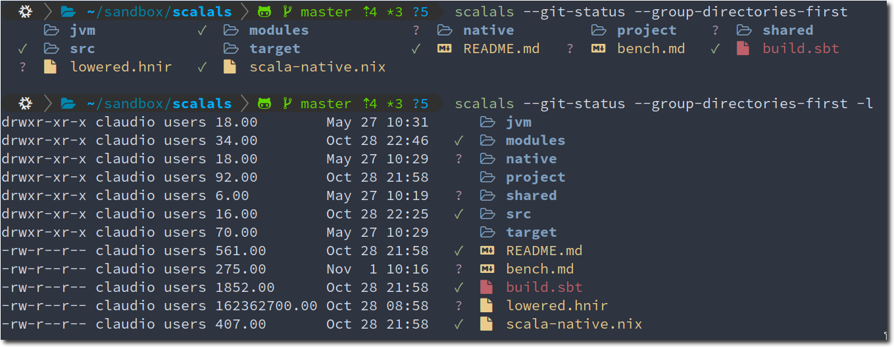

# About

This is yet another [colorls](https://github.com/athityakumar/colorls) clone.

# Features

1. fast (compiled to native code)
2. aims to be a drop-in replacement to GNU ls
3. supports `LS_COLORS`

# Install

_Note_: scalals binaries are currently available for Linux and MacOS on amd64 and arm64.

## Using [coursier](https://get-coursier.io/)

1. run `cs install --contrib scalals`

(run this again to install the latest version)

## Using [DotSlash](https://dotslash-cli.com/)

1. install `dotslash` (see https://dotslash-cli.com/docs/installation/)
2. run `curl -fL https://github.com/avdv/scalals/releases/latest/download/scalals -o scalals`
3. run `chmod +x scalals`
4. run `./scalals`

The DotSlash file supports Linux and macOS on x86_64 and aarch64. It is pinned to the release it was downloaded from; run step 2 again to update.

## With nix flakes

1. `cachix use cbley` (optional, avoids re-building)
2. run `nix profile install github:avdv/scalals`

## Manually

1. download a pre-built [binary](https://github.com/avdv/scalals/releases/latest) for your platform
2. ensure it is found in your `PATH`
3. run `chmod +x path/to/scalals`

# Setup

1. install a Nerd Font from [here](https://www.nerdfonts.com/font-downloads) and use it in your terminal emulator
2. set up your dircolors (see https://www.nordtheme.com/ports/dircolors for example)

# Building

1. run `cachix use cbley` (optional)
2. run `nix-build` or `nix build` (flake)
3. binary is in `result/bin/`

